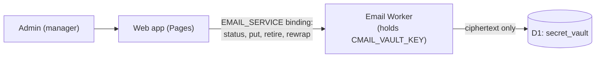

# Secret vault

Status: **built, off by default, not yet used by any feature and not yet
tested on a deployed Worker.** This is the first part of the Microsoft 365
setup wizard. Later releases let the wizard store the keys and secrets it
creates here, so nobody has to paste them into `wrangler secret put`.

The vault is an encrypted table in D1 (`secret_vault`, migration `0030`). It
holds values that cMail itself generates or receives during setup, for
example an Entra app's private key or the Exchange journal address. Only the
email Worker can decrypt them. The web app can store a value or ask for
status, but it can never read a value back.

## What changes for an existing instance

Nothing. Every existing Worker secret keeps working exactly as before:

- **Env-first.** When the env secret for a name is set (for example
  `M365_CLIENT_SECRET`), it always wins and the vault is not read at all. The
  vault is used only when that env secret is absent, which means only for
  values the wizard stored.
- No feature reads the vault in this release. Without `CMAIL_VAULT_KEY` and
  without migration `0030`, behaviour is unchanged.

## How it works



- **Encryption.** AES-256-GCM with a random 96-bit nonce per value and a
  128-bit tag (Web Crypto, supported in Workers:
  <https://developers.cloudflare.com/workers/runtime-apis/web-crypto/#supported-algorithms>).
- **Key derivation.** The data key is derived with HKDF-SHA-256 from one
  Worker secret, `CMAIL_VAULT_KEY` (32 random bytes). A separate HKDF output
  gives the key id (`v1-` and 16 hex characters), which is stored with each
  row. The key id is a fingerprint: it does not reveal the key. The `v1-`
  prefix names the scheme, so a later scheme can sit beside it.
- **Binding (AAD).** Each ciphertext is bound to its row through additional
  authenticated data: this instance's vault id, the row id, the secret name,
  the version and the purpose. A ciphertext copied into another row, renamed,
  given another version or purpose, copied to another cMail instance (even
  one that uses the same key), or changed by one bit does not decrypt. The
  read fails closed (`decrypt_failed`) and returns nothing. The instance id
  is a random value the Worker writes once, on the first vault write, to
  `secret_vault_instance`. Use one key per instance anyway.
- **Not bound: `status`.** Whether a row is active or retired is not in the
  AAD, so retiring needs no key. Someone who can write to D1 can therefore
  make an older, retired version active again. That needs D1 write access,
  which already allows far more, and the older value was a real value of
  this instance.
- **Names are an allow-list** (`packages/shared/src/secret-vault.ts`). Each
  name has a purpose, a size limit and, where one exists, the env secret that
  wins over it:

| Vault name | Env secret that wins | Purpose |
|---|---|---|
| `m365.sync.client_secret` | `M365_CLIENT_SECRET` | entra-client-secret |
| `m365.copyback.client_secret` | `M365_COPYBACK_CLIENT_SECRET` | entra-client-secret |
| `m365.perms.cert_pfx_b64` | `M365_EXO_CERT_PFX_B64` | exo-certificate |
| `m365.perms.cert_password` | `M365_EXO_CERT_PASSWORD` | exo-certificate-password |
| `m365.journal.address` | `M365_JOURNAL_ADDRESS` | journal-address |
| `entra.signin.private_key` | none (vault only) | entra-app-private-key |
| `entra.sync.private_key` | none (vault only) | entra-app-private-key |
| `entra.perms.private_key` | none (vault only) | entra-app-private-key |

- **Versions.** Storing a value again creates the next version and retires
  the previous one in the same D1 batch. At most one version per name is
  active (a unique index enforces it). Retired rows are kept, so a rollback
  can see what was there. This release never deletes a vault row.

## The private RPC

The web app reaches the vault only over the existing `EMAIL_SERVICE` service
binding, at `https://cmail-email-worker.internal/internal/vault/<operation>`.
The Worker refuses every other hostname, as it does for its other internal
endpoints. Only these operations exist. Any other path or method gets 404:

| Operation | Method | What it does | Returns |
|---|---|---|---|
| `status` | GET | Per name: env set or not, the source a reader would use (`env`, `vault` or `none`), version, key id, whether it needs rewrap, expiry. Also the state of the current and previous key | names, versions and key ids only |
| `put` | POST | Stores a new version of an allow-listed name | name, version, key id, `shadowedByEnv` |
| `retire` | POST | Retires the active version (for wizard rollback) | count |
| `rewrap` | POST | Re-encrypts up to 100 rows under the current key | counts |

There is no `get`, `decrypt` or `export`. A value goes in and never comes back
out over the binding. Every write must name a cMail user id (`actorId`), and
the Worker checks again in D1 that it belongs to an active manager (not
paused, not offboarded). A refused write is logged and audited as
`vault.request_refused` with the operation and a code only. The web-side
client is `apps/web/src/lib/server/vault-client.ts`.

**The service binding is the trust boundary.** The Worker cannot see the
browser session: it trusts that whoever calls it over `EMAIL_SERVICE` is the
web app, and it only checks that the named user is an active manager. So the
web route that calls the vault (the setup wizard, from the next release on)
must itself require a signed-in manager session, the per-session CSRF token
and the `Origin` check before it calls `put`, `retire` or `rewrap`, and it
must pass the session's own user id, never one from the request body.

Errors are stable codes only: `vault_key_missing`, `vault_key_invalid`,
`key_unavailable`, `decrypt_failed`, `not_installed`, `unknown_name`,
`invalid_value`, `invalid_request`, `write_conflict`.

## Logging and audit

- No value, key or ciphertext is ever logged, returned to the browser or
  written to `audit_log`. Logs carry the operation and an error code, or only
  an error's name. The tests check that a stored value appears in no response,
  no log line and no audit row.
- Every write, retirement and rewrap writes an `audit_log` row:
  `vault.secret_written`, `vault.secret_retired` or `vault.rewrapped`, with the
  acting manager, the name, the version and the key id. A refused write from
  someone who is not an active manager writes `vault.request_refused` with
  the operation and a code only.

## Setting up the key

Cloudflare never shows a Worker secret again after it is set, so save the
key in your password manager **before** you give it to Wrangler:

1. Generate the key into a file only you can read, in a folder outside the repository (so it can never be committed):

   ```sh
   umask 077
   node -e "console.log(require('crypto').randomBytes(32).toString('base64'))" > vault-key.txt
   ```

2. Open `vault-key.txt`, copy the line into a new password manager entry
   (for example "cMail vault key, <instance>, set <date>") and save it.
3. Set it as the Worker secret from the file, then delete the file:

   ```sh
   wrangler secret put CMAIL_VAULT_KEY --config apps/email-worker/wrangler.toml < vault-key.txt
   rm vault-key.txt
   ```

On Windows use PowerShell 7 the same way
(`Get-Content vault-key.txt | wrangler secret put ...`, then
`Remove-Item vault-key.txt`). Then apply migration `0030` with the normal
`pnpm db:migrate`.

### Custody: the organisation keeps the key

- The organisation that runs the instance keeps a copy of `CMAIL_VAULT_KEY`
  in **its own password manager**. Nobody else holds an escrow copy; the
  maintainers do not keep one.
- **Losing the key never loses mail.** The vault holds setup credentials
  only. Mail, mailboxes, accounts and settings are not in it.
- **What stops working if the key is lost**, until setup is run again with a
  new key (or the env secrets are set by hand):
  - values that exist only in the vault (`entra.signin.private_key`,
    `entra.sync.private_key`, `entra.perms.private_key`): Microsoft sign-in
    and the Microsoft 365 sync (and shared mailbox access) once they use
    certificates from the vault;
  - any other name whose env secret is not set (for example the journal
    address, so the Exchange mirror stops filing reports).
  Names whose env secret is set keep working, because the env wins. Re-running
  the wizard stores new versions under the new key; the unreadable old rows
  stay as they are and can be retired.

## Rotating the key

Order matters, so that no moment exists when the running Worker lacks the
key its rows need:

1. Save the new key in the password manager (see above). Keep the old entry.
2. Set the **old** key as `CMAIL_VAULT_KEY_PREVIOUS` first. Nothing changes
   yet: it equals the current key.
3. Then set the **new** key as `CMAIL_VAULT_KEY`. Both keys can now decrypt;
   new values use the new key.
4. Call `rewrap` (a later Admin page has a button for it) until `remaining`
   is 0. Each row is re-encrypted with a fresh nonce. The update is guarded by
   the row's old key id and nonce, so a value stored at the same moment wins.
   Rows that no available key can read are skipped, counted as `unreadable`
   and left as they are; they are never deleted.
5. `status` shows no name with `needsRewrap`. Then delete
   `CMAIL_VAULT_KEY_PREVIOUS` from the Worker.
6. **Keep the old key in the password manager** for as long as D1 Time Travel
   or your backups can restore a database from before the rotation (30 days
   on Workers Paid, 7 on Free, longer for kept backups). Delete it only after
   that window.

Rotating a single **value** (for example a new app secret) is simply another
`put`: it creates the next version.

## Restores and backups

- **D1 Time Travel restores the vault rows like any other table**
  (<https://developers.cloudflare.com/d1/reference/time-travel/>). The key
  is **not** in D1. A restored database needs the same `CMAIL_VAULT_KEY`
  that encrypted those rows (or that key as `CMAIL_VAULT_KEY_PREVIOUS` after
  a rotation). Restoring to a point before a key rotation needs the old key
  (keep it for the retention window, see above); without it those rows are
  unreadable (`key_unavailable`) and setup must be re-run.
- A restore is a rollback of the vault too: a version that was retired after
  the restore point is **active again**, a newer version disappears, and the
  vault's `audit_log` rows after that point are gone with the rest of the
  database. After a restore, check `status` and, if needed, store the
  current values again (or retire the reactivated ones). Entra and Cloudflare
  keep their own audit logs, which a D1 restore does not touch.
- The optional backup Worker copies D1 as it is, so backups hold ciphertext
  only. Keep the key with the restore runbook's secrets, not with the backup.
- An exported D1 file, a restored copy or a leaked backup alone gives no
  usable secret.

## Setup runs (`setup_run`)

Migration `0030` also adds `setup_run`, one row per wizard session. It holds
the manager who started it, the step state, the plans (no secrets) and the
session's delegated admin tokens. The tokens are one blob encrypted under
the same key, bound to the instance id and the run id. They are deleted at Finish, Disconnect or
after 90 minutes. Nothing writes this table in this release; the Connect
flow in a later release does.

## What this does not protect against

Code running inside the email Worker can decrypt the vault, just as it can
read the Worker's env secrets today, so the exposure inside the Worker is
the same. What changes is that D1 exports, restores and backups no longer
hold usable secrets. The key in one Worker secret is a single point: back it
up as described above.

## Not verified yet

- Not yet run on a deployed Worker or against real D1 (tested with
  `node:sqlite` and the real migrations).
- No feature reads the vault yet. Wiring it into the sync, copy-back,
  permissions and mirror settings (env-first) comes with the wizard's next
  parts.
