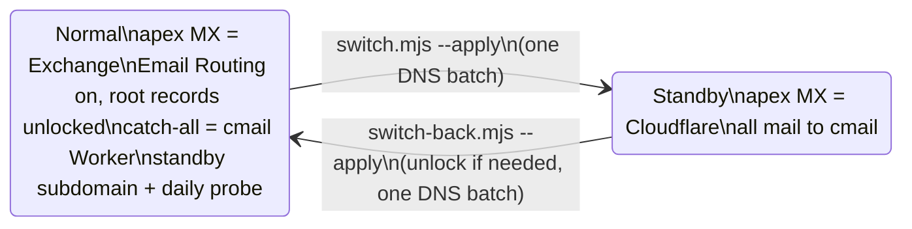

# Switch mail to the cmail standby, and back

When Exchange Online (or another mail provider) stops receiving, cmail can
take the domain's incoming mail: the domain's MX records are pointed at
Cloudflare Email Routing, whose catch-all hands every message to the cmail
email Worker. When the provider is back, the MX records are restored and the
mail that arrived meanwhile can be copied back
([Copy standby mail back into Exchange](copy-back.md)).

Two scripts do the DNS part, each in one change:

- `scripts/standby/switch.mjs` points the apex MX at Cloudflare.
- `scripts/standby/switch-back.mjs` restores the original MX from the
  snapshot the switch saved.

> **Status:** built, **not yet run against a real Cloudflare zone.** The
> scripts are tested only against a mocked Cloudflare API. Part of the design
> rests on Cloudflare behaviour that is not documented (see
> [Proven and not proven](#proven-and-not-proven)); the first real use must be
> the [First-time setup](#first-time-setup) drill in a quiet window.

> **DNS changes are always run by a person, after the owner's yes.** Both
> scripts are dry runs unless `--apply` is given, and `--apply` also needs the
> domain typed at an interactive terminal. They refuse `--apply` when `CI` is
> set and when input is piped. Never automate them.

## Proven and not proven

| What the design relies on | Source | |
|---|---|---|
| Email Routing needs **exclusive control of the root domain's MX records**: onboarding a domain that has another provider's MX fails with error 2008, "Non-Cloudflare MX records exist". | Cloudflare [Troubleshooting](https://developers.cloudflare.com/email-service/reference/troubleshooting/), [Domains](https://developers.cloudflare.com/email-service/configuration/domains/#move-to-email-routing-from-another-provider) | Documented |
| Cloudflare's way in from another provider: delete that provider's MX, enable Email Routing (Cloudflare adds its MX and a `cf2024-1._domainkey` DKIM record; SPF only if none exists, otherwise **add `include:_spf.mx.cloudflare.net` by hand**), then create routing rules at once, because with Cloudflare's MX in place **mail to an address with no rule is rejected ("Address does not exist") and the sender does not retry**. Keep the other provider's include and DKIM if you still send through it. | [Domains: Move to Email Routing](https://developers.cloudflare.com/email-service/configuration/domains/#move-to-email-routing-from-another-provider) | Documented |
| Email Routing's root records (MX, SPF, DKIM) can be **unlocked** and edited to point to another provider. An edited record stays associated with Email Routing and is deleted if Email Routing is disabled. | [Domains: Locked DNS records](https://developers.cloudflare.com/email-service/configuration/domains/#locked-dns-records), [Remove a domain from Email Routing](https://developers.cloudflare.com/email-service/configuration/domains/#remove-a-domain-from-email-routing) | Documented |
| Subdomain routing (the [standby address](standby-probe.md) `name@standby.<domain>`) is added from the **apex domain's** Email Routing Settings, with literal rules only; the catch-all exists only on the apex. | [Subdomains](https://developers.cloudflare.com/email-service/configuration/subdomains/) | Documented |
| A DNS batch (`POST /zones/{id}/dns_records/batch`) runs deletes, patches, puts, posts in **one database transaction: all or nothing**. Propagation to Cloudflare's edge is per record, not atomic. | [Batch record changes](https://developers.cloudflare.com/dns/manage-dns-records/how-to/batch-record-changes/) | Documented |
| `GET /zones/{id}/email/routing` gives `enabled` and `status` (`ready`, `unconfigured`, `misconfigured`, `misconfigured/locked`, `unlocked`); `GET .../email/routing/dns` lists the DNS records Email Routing needs; `PATCH .../email/routing/dns` unlocks them; `GET .../email/routing/rules/catch_all` reads the catch-all. | [Email Routing API](https://developers.cloudflare.com/api/resources/email_routing/) | Documented |
| **The prepared state: Email Routing enabled on the zone, root MX unlocked and pointing at Exchange, the standby subdomain still routing to cmail.** | none | **Not proven.** Cloudflare documents unlocking only as a step on the way out. The [First-time setup](#first-time-setup) drill is where this is first observed. |
| That MX records the switch creates through the DNS API (the same `*.mx.cloudflare.net` hosts and priorities Cloudflare lists) make Email Routing accept apex mail again, without calling Cloudflare's Enable. | none | **Not proven.** The docs only describe Cloudflare adding them itself. Verify on the drill. |
| What `GET .../email/routing/dns` returns while the apex points elsewhere. If it lists no MX, the switch stops and asks for `--cloudflare-mx` (copied from Email Routing > Settings). | none | **Not proven** |
| Whether Email Routing needs `include:_spf.mx.cloudflare.net` when it delivers to a Worker (Cloudflare says the record authorises it to forward). The switch adds it because Cloudflare says to; `--no-spf-change` skips it. | [Domains: Routing records](https://developers.cloudflare.com/email-service/configuration/domains/#routing-records) | Not proven either way |
| The probe reading needs the standby probe's tables (migration `0023`, [standby test address and probe](standby-probe.md)). | this repo | Depends on that feature being deployed |

The headline case people ask about, "apex MX at Exchange, standby on a
subdomain", is therefore the **unproven** part. The switch is built so it does
not depend on it more than it must: at switch time it replaces the apex MX
with exactly the records Cloudflare lists, with the catch-all already in
place, which is what Cloudflare documents for moving to Email Routing.

## How it works



**switch.mjs** reads, then checks, then (only with `--apply` and the typed
domain) changes:

1. The zone: exactly one Cloudflare zone named `--domain`, type `full` (DNS
   hosted on Cloudflare), `active`. A subdomain or a partial (CNAME) or
   secondary zone is refused.
2. Email Routing: `enabled` with status `unlocked`, `misconfigured` or
   `ready`. Not enabled is refused with a pointer to
   [First-time setup](#first-time-setup) (Cloudflare would refuse with 2008);
   `misconfigured/locked` is refused (unlock first).
3. The catch-all: enabled, matcher `all`, a single action `worker` to exactly
   `--worker`. Otherwise refused. Literal apex rules that send elsewhere are
   listed as warnings (they take those addresses first).
4. The probe: with `--probe-d1 <database-id>` it reads the
   [standby probe](standby-probe.md) light from D1 (two SELECTs, read-only)
   and refuses anything but **green** (the same rules as Admin > Standby test).
   An unreadable probe is refused unless `--skip-probe-check`. `--apply`
   without `--probe-d1` needs `--skip-probe-check`, which is printed loudly.
   `--skip-probe-check` never overrides a probe that reads amber or red.
5. The apex MX: at least one, none proxied, none already Cloudflare's (all
   Cloudflare's means "already switched, nothing to do"; a mix is refused).
   Every MX TTL must be at most `--max-ttl` (default 300 s; Auto counts as
   300 s); if not, it prints how to lower them and stops.
6. The target: the MX records Cloudflare lists in Email Routing's DNS
   settings for the apex, each a `*.mx.cloudflare.net` host with a priority.
   `--cloudflare-mx host:priority,...` is accepted only when Cloudflare lists
   none, and must also be `*.mx.cloudflare.net`.
7. SPF (unless `--no-spf-change`): the one apex SPF record gains
   `include:_spf.mx.cloudflare.net` right after `v=spf1`, keeping every
   existing term. Refused if there are two SPF records, if the record is split
   into several strings, or if the top-level lookups would exceed 10. If there
   is no SPF record it creates none (a Cloudflare-only record would stop
   authorising Exchange) and warns.

It prints the records now, the **change set**, the **reverse change set**,
and warnings, and saves a **snapshot** (below) every time it reads an apex
that is not Cloudflare's, refused or not. With `--apply` it asks for the
domain to be typed, re-reads the MX and SPF records and stops if they changed
while it waited, sends **one DNS batch** (delete the old MX, edit SPF, add
Cloudflare's MX with Auto TTL and the comment `cmail standby switch <time>`),
re-reads, and compares. Exit code 0 = done, 1 = refused or failed (nothing
changed), 2 = applied but the records are not as planned (it prints the
switch-back command).

**switch-back.mjs** checks the snapshot (format, SHA-256 checksum, written by
the switch, same domain, same zone id), reads the zone, and plans: delete the
apex MX records that are Cloudflare's, re-create every original MX exactly
(host, priority, TTL, comment), and put SPF back **only if it still holds what
the switch wrote** (an SPF record edited since is left alone, with a
warning). Any apex MX that is neither Cloudflare's nor in the snapshot stops
it. If Email Routing is enabled and its status is not `unlocked`, it first
unlocks the records (`PATCH .../email/routing/dns`, Cloudflare's documented
step before pointing MX elsewhere); then one DNS batch; then it re-reads and
compares. (If the batch fails after the unlock, the MX are unchanged and the
records stay unlocked; fix the cause and run it again.) It never touches routing rules, the catch-all, the standby
subdomain, or Email Routing itself: the catch-all keeps sending to cmail, so
senders that cached Cloudflare's MX are still delivered.

### What changes and what is left alone

| Record | Switch | Switch-back |
|---|---|---|
| Apex MX | Old provider's deleted, Cloudflare's added (one batch) | Cloudflare's deleted, originals re-created (one batch) |
| Apex SPF | `include:_spf.mx.cloudflare.net` added, all else kept | Restored, if unchanged since |
| DKIM (Exchange `selector1`/`selector2` CNAMEs, Cloudflare `cf2024-1`) | Untouched | Untouched |
| DMARC (`_dmarc`) | Untouched | Untouched |
| Standby subdomain MX, routing rules, catch-all | Untouched (checked) | Untouched |
| Everything else (web, autodiscover, verification records) | Untouched | Untouched |

**Exchange outbound keeps working.** Outbound mail does not use the MX
records. It relies on SPF (Exchange's `include:spf.protection.outlook.com`
stays), DKIM (the selector CNAMEs stay) and DMARC (stays), so people can still
send from Outlook if Exchange itself is up. The switch warns if the SPF record
does not include `spf.protection.outlook.com`. cmail's own sending goes
through Cloudflare Email Sending on the `cf-bounce` subdomain
([sending](sending.md)) and is not affected by the switch.

### Snapshots

`standby-snapshots/<domain>-<UTC time>-switch-<dry-run|apply>.json` (change
the folder with `--snapshot-dir`). It holds the apex MX, SPF, DMARC, DKIM and
standby-subdomain records as read, Email Routing's status, the SPF edit, the
Cloudflare MX used, and a SHA-256 checksum. After `--apply`, a
`.result.json` beside it holds the records afterwards. Switch-back writes its
own `...-switch-back-...json` (the records before it ran; it cannot be used as
a switch-back source). Files are created owner-only and never overwritten.
**They contain the domain's real DNS data: keep them private and out of git**
(`standby-snapshots/` is in `.gitignore`). Keep the apply snapshot until the
switch-back is done and verified.

### Token permissions

The scripts read `CLOUDFLARE_API_TOKEN` from the environment and never print
it (error text is scrubbed, requests go only to
`https://api.cloudflare.com/client/v4/`, redirects are refused). Use a token
scoped to the one zone (and the one account for D1):

| Permission | Used for |
|---|---|
| Zone > Zone > Read | finding the zone |
| Zone > DNS > Read | reading records (dry runs) |
| Zone > Zone Settings > Read | Email Routing settings and its DNS list |
| Zone > Email Routing Rules > Read | catch-all and rules |
| Account > D1 > Read | the probe (only with `--probe-d1`; also set `CLOUDFLARE_ACCOUNT_ID`) |
| Zone > DNS > Write | `--apply` (the batch) |
| Zone > Zone Settings > Write | switch-back `--apply` when records must be unlocked |

A read-only token is enough for every dry run. Give the write permissions
only to the people who may change DNS, and set the token for the session only:

```sh
read -rs CLOUDFLARE_API_TOKEN && export CLOUDFLARE_API_TOKEN   # paste, Enter
export CLOUDFLARE_ACCOUNT_ID=<account id>                        # for --probe-d1
```

```powershell
$env:CLOUDFLARE_API_TOKEN = Read-Host -MaskInput 'Cloudflare token'
$env:CLOUDFLARE_ACCOUNT_ID = '<account id>'
```

## First-time setup

Once per domain, before the standby can be relied on. **Needs the owner's yes
and a quiet window**: for a few minutes the domain's mail goes to cmail. This
is also the drill that proves the unproven rows above, so plan to stop and
switch back if anything looks wrong.

Before the window:

1. The domain's DNS is on Cloudflare (full setup). cmail is deployed for
   `MAIL_DOMAIN`, and every person has a cmail mailbox
   ([Microsoft 365 mailbox sync](m365-sync.md)) and can sign in
   ([staff sign-in](staff-sign-in.md)).
2. Lower the apex MX TTL to Auto (300 s) and wait out the old TTL.
3. Take the snapshot of the original records with a dry run. It is refused
   ("Email Routing is not enabled") but saves
   `...-switch-dry-run.json`; keep that file:
   ```sh
   node scripts/standby/switch.mjs --domain example.com --worker <email-worker-name>
   ```

In the window (dashboard, following Cloudflare's
[Move to Email Routing](https://developers.cloudflare.com/email-service/configuration/domains/#move-to-email-routing-from-another-provider)):

4. DNS > Records: delete the old provider's apex MX records.
5. Compute > Email Service > Email Routing > Onboard Domain: choose the
   domain. Cloudflare adds its MX and the `cf2024-1` DKIM record. Add
   `include:_spf.mx.cloudflare.net` to the existing SPF record by hand, right
   after `v=spf1` (the switch-back step below then removes it again; leave it
   out if you prefer, see the SPF row above).
6. At once: Routing rules > Catch-all address > Send to a Worker > the cmail
   email Worker, enabled. (Until this exists, mail to the domain is rejected
   without retry.)
7. Settings > Subdomains: add `standby.<domain>` and the probe's literal rule
   ([standby probe](standby-probe.md)).
8. Send a test from an outside mailbox to a real person; it should appear in
   cmail.
9. Put mail back on the old provider, from the snapshot of step 3:
   ```sh
   node scripts/standby/switch-back.mjs --domain example.com --snapshot standby-snapshots/<file>-switch-dry-run.json
   node scripts/standby/switch-back.mjs --domain example.com --snapshot standby-snapshots/<file>-switch-dry-run.json --apply
   ```
   It unlocks Email Routing's root records and restores the original MX.

After the window, record what you saw (this is the evidence the design
lacks): Email Routing's status in the dashboard, that `standby.<domain>`
still receives (Admin > Standby test goes green within a day, or press Run
test now), and that a switch dry run now passes every check. If the standby
subdomain stops receiving while the apex points to Exchange, the prepared
state is not workable on Cloudflare as it stands: stop and rethink before
relying on the standby.

## Pre-flight checklist (before every switch)

- [ ] **The owner's yes** to switch this domain now, given after reading the
      dry-run output.
- [ ] **Who can change DNS** is known and reachable: the person running the
      script has a token with the write permissions above, and a second person
      knows the switch is happening. The list of these people lives with the
      instance's own records, not in this repo.
- [ ] **TTL lowered:** the dry run shows every apex MX at 300 s or Auto, set
      at least the old TTL ago.
- [ ] **Probe green:** Admin > Standby test is green and the dry run with
      `--probe-d1` says GREEN.
- [ ] **Sign-in tested:** someone signed in to cmail today the way staff will
      (Access, and passkeys if Entra is down). If Entra is down, check that
      the people who need mail have a working session or passkey.
- [ ] **Mailboxes exist:** Admin > Microsoft 365 sync ran recently without a
      held change; new starters have mailboxes.
- [ ] **Routing ready:** the dry run shows the catch-all sending to the
      Worker and no warnings about literal rules or the standby subdomain.
- [ ] The snapshot folder is private and has room.
- [ ] People know to read mail in cmail for now (a message from a channel
      that does not depend on the failed mail system).

## Switch

1. Set the token for this session (see [Token permissions](#token-permissions)).
2. Dry run, and read all of it:
   ```sh
   node scripts/standby/switch.mjs --domain example.com --worker <email-worker-name> --probe-d1 <d1-database-id>
   ```
3. Send the change set to the owner and wait for the yes.
4. Apply, and type the domain when asked:
   ```sh
   node scripts/standby/switch.mjs --domain example.com --worker <email-worker-name> --probe-d1 <d1-database-id> --apply
   ```
5. Note the snapshot path it prints and the time. You need both to switch
   back and to copy mail back.

## Verify mail is arriving

1. `dig +short MX example.com @1.1.1.1` and `@8.8.8.8` list the Cloudflare
   hosts. Other resolvers may give the old answer until the old TTL passes.
2. Send from an outside mailbox (another provider) to a real person: the
   message appears in cmail within a minute or two and in Admin > Mail trace.
3. Cloudflare dashboard > Email Routing > Activity shows the message
   delivered to the Worker, not dropped or rejected.
4. Admin > Standby test: Run test now stays green.
5. If Exchange is still up for sending: send from Outlook to an outside
   mailbox and check the received headers show SPF, DKIM and DMARC pass.

If mail is rejected or not arriving: check the catch-all in the dashboard,
then Activity for the reason, then [receiving](receiving.md). If in doubt,
switch back.

## Switch back

1. When the provider receives again (check its service health), dry run:
   ```sh
   node scripts/standby/switch-back.mjs --domain example.com --snapshot standby-snapshots/<file>-switch-apply.json
   ```
2. The owner's yes, then the same with `--apply`, typing the domain.
3. Verify: `dig +short MX example.com @1.1.1.1` shows the original hosts; an
   outside test message reaches Exchange (Outlook); Admin > Standby test is
   still green (the standby address keeps working for next time).
4. Mail that arrived in cmail meanwhile:
   - It stays in cmail; nothing is moved or deleted, and people can keep
     reading it there.
   - Senders with the Cloudflare MX cached, and retries, keep arriving in
     cmail for a while (up to the MX TTL, longer for retries). The catch-all
     still sends to the Worker, so these are not lost.
   - Copy it into Exchange with Admin > Copy back to Exchange
     ([copy-back](copy-back.md)). Use the window the script prints: from the
     switch to one hour after the switch-back (UTC), and start it after that
     hour. Messages Exchange already has are skipped by Message-ID, so a wide
     window is safe; run a second job later if stragglers arrive.

## What it cannot do

- **Mail Microsoft already accepted stays with Microsoft.** Messages
  Exchange Online Protection accepted or queued before the switch are
  delivered by Microsoft when Exchange recovers; they never reach cmail.
- **Internal mail does not use MX.** Mail between people in the same
  Microsoft 365 tenant is delivered inside Exchange and is not redirected.
- **Senders that cached the MX.** Until the old TTL passes (300 s if you
  lowered it; some resolvers keep answers longer), some senders still deliver
  to the old provider after the switch, and to cmail after the switch-back.
- **Timing is not instant.** Cloudflare applies the batch in one
  transaction, but its edge picks the records up one by one, and senders
  retry deferred mail on their own schedules (minutes to days).
- **Not a first-time setup.** It does not enable Email Routing, create the
  catch-all, or add the standby subdomain; see
  [First-time setup](#first-time-setup).
- **Apex domains on Cloudflare DNS only**, one domain per run. A domain with
  several mail domains needs a run per domain.
- **It bypasses a mail gateway.** If the apex MX point at a filtering
  gateway rather than Exchange, the switch replaces the gateway too, and
  switch-back restores it.
- **It does not check sign-in, sending, or the mail itself**; the checklist
  and the verify steps do.

## When it refuses

| It says | Do |
|---|---|
| `No Cloudflare zone named ...`, `not "full"` | The domain's DNS is not on Cloudflare, or you passed a subdomain. |
| `Email Routing is not enabled` | [First-time setup](#first-time-setup). |
| `misconfigured/locked` | Email Routing > Settings > DNS records > Unlock. |
| `catch-all rule must be enabled and send to Worker` | Routing rules > Catch-all address > Send to a Worker. |
| `TTL above ...` | Lower the TTL as printed and wait out the old one. |
| `probe is red/amber/off` | Admin > Standby test: fix the reason, Run test now. |
| `Could not read the standby probe` | Check `CLOUDFLARE_ACCOUNT_ID`, the D1 id and the token's D1 Read; or check Admin yourself and pass `--skip-probe-check`. |
| `listed no Email Routing MX records` | Copy the MX from Email Routing > Settings and pass `--cloudflare-mx`. |
| SPF refusals | Fix SPF by hand, or `--no-spf-change`. |
| `half-switched`, `neither Cloudflare's nor in the snapshot` | Someone changed DNS. Compare the zone with the snapshot by hand. |
| `changed since they were read` | Run the dry run again. |
| Exit code 2 | The batch applied but the records differ from the plan: check the dashboard now; the output has the switch-back command. |

## Code and tests

- `scripts/standby/switch.mjs`, `scripts/standby/switch-back.mjs` (entry
  points, `--help`), `scripts/standby/lib/` (`cloudflare.mjs` API client,
  `mail-dns.mjs` checks and change sets, `probe.mjs` probe light,
  `snapshot.mjs`, `cli.mjs`).
- Tests: `scripts/standby/test/` against an in-memory Cloudflare API (no
  network): dry runs make no writes, every refusal, the typed confirmation,
  CI refusal, token redaction, SPF edge cases, batch failure, a full switch
  and switch-back round trip, unlocking, a tampered snapshot, and the
  First-time setup sequence. Run `pnpm test:standby-scripts`; it is part of
  `pnpm validate`.
- No migration, no Worker or web app change.

## Sources

- Cloudflare: [Domains](https://developers.cloudflare.com/email-service/configuration/domains/)
  (move from another provider, routing records, locked records, disabling),
  [Subdomains](https://developers.cloudflare.com/email-service/configuration/subdomains/),
  [Troubleshooting](https://developers.cloudflare.com/email-service/reference/troubleshooting/)
  (error 2008),
  [Postmaster](https://developers.cloudflare.com/email-service/reference/postmaster/)
  (MX hosts and SPF),
  [Batch record changes](https://developers.cloudflare.com/dns/manage-dns-records/how-to/batch-record-changes/),
  API reference for [Email Routing](https://developers.cloudflare.com/api/resources/email_routing/),
  [DNS records](https://developers.cloudflare.com/api/resources/dns/subresources/records/),
  [Zones](https://developers.cloudflare.com/api/resources/zones/methods/list/) and
  [D1 query](https://developers.cloudflare.com/api/resources/d1/subresources/database/methods/query/),
  [TTL](https://developers.cloudflare.com/dns/manage-dns-records/reference/ttl/)
  (Auto is 300 seconds).
- RFC 7208 (SPF), section 4.6.4: at most 10 DNS-querying terms.
